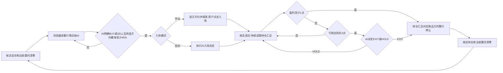

# 当前交易流程

唯一流程：核实空仓与当前委托清零，读取浏览器行情，AI决定方向，判断所选方向盈利概率是否至少45%，手动或自动入场，持续监控持仓汇总，盈利≥1点立即整行离场；亏损≤-2点请求AI判断，AI决定离场则整行转让，核实清零后开始下一轮。

多单点差=当前可成交bid−汇总订立均价；空单点差=汇总订立均价−当前可成交ask。不乘数量，不是金额、百分比或K数；未知费用不当零，不把点差声称为已核实净利润。边界包括+1和-2。达到或跳过+1立即离场，不等待AI；达到或跌破-2请求AI判断。

亏损AI离场请求独立于入场分析，逐商品和方向返回EXIT或HOLD及依据。HOLD不提交交易；价格变化或判断过期后再次请求。EXIT仅绑定当时商品、方向、均价、数量和触发类型，行情采集后60秒到期；持仓变化、价格退出触发区间、停止任务均使旧判断失效。请求失败显示原因并重试，不编造决定。

点击及确认前重新核实整行均价、数量、冻结量、新鲜可成交报价；亏损离场另核对AI授权。不能降级逐仓操作。已提交或结果未知时先核实，禁止重复转让。实际清零才结束本轮，不以点击成功代表成交，不额外等待下一K。当前委托满120秒撤未成交余量；过往待核实记录在提交至少120秒后，只有新鲜持仓、汇总和当前委托均清零才记为现场已清零，不伪造历史成交或撤单结果。

已移除：0.5点自动离场、3点救单及两笔反向订单、恢复金额≥-1退出、10分钟救单/5分钟目标兜底、持仓期间追加普通单、逐仓条件平仓、收盘自动清仓、额外市场阶段与同K入场锁。

桌面和服务端必须配套更新；新版能力browser-ai-summary-exit-v1。旧客户端不能执行新策略。所有验证使用隔离页面与模型，不提交真实交易。
